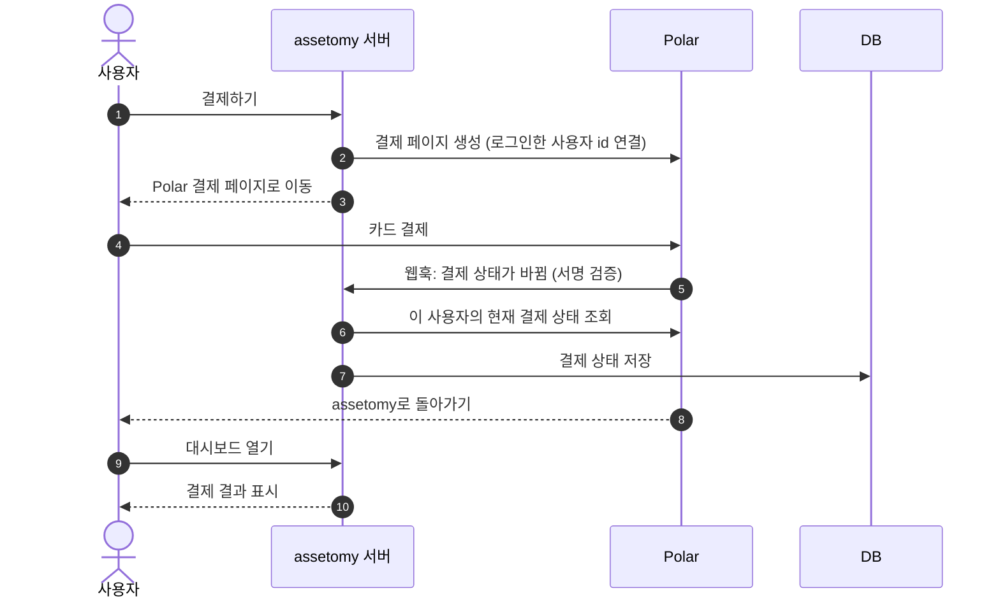

# assetomy

신용카드 이용내역 파일을 올리면 소비 현황과 확인이 필요한 지출 후보를 보여주는 핀테크 SaaS MVP.

- 기획 `docs/PRD.md` · 화면 흐름 `docs/USER_FLOW.md` · 설계 `docs/ARCHITECTURE.md`·`docs/ADR.md` · 화면 규칙 `docs/DESIGN.md`
- 개발 명령과 규칙은 `CLAUDE.md`

## 결제는 어떻게 안전한가

결제는 [Polar](https://polar.sh)가 처리하고, assetomy는 카드 정보를 받거나 저장하지 않는다.
assetomy가 책임지는 것은 **"누가 Pro인가"를 위조되거나 틀리지 않게 판단하는 것**이다(ADR-012).

### 결제 흐름

웹훅(5~7)과 사용자 복귀(8~10)는 어느 쪽이 먼저 와도 된다. 사용자가 먼저 돌아오면 assetomy가 Polar에 직접 물어보고 저장한다.

### 핵심 원칙

1. **Pro 여부의 정답은 Polar, DB는 사본이다.** 화면·기능은 DB 값으로 판단하지만, DB 값은 Polar가 직접 답한 현재 상태로만 바뀐다. DB를 손으로 고쳐도 다음 동기화 때 Polar 값으로 돌아온다.
2. **웹훅은 "다시 확인하라"는 신호일 뿐이다.** 페이로드의 구독 상태는 쓰지 않고, `external_id`(우리 사용자 id)만 꺼내 Polar에 다시 묻는다.
3. **사용자 id는 로그인 세션에서만 꺼낸다.** 요청 본문·쿼리·헤더의 값으로 사용자나 플랜을 정하지 않는다.

동기화(`syncFromPolar`)는 항상 같은 세 단계다.

1. 조회 **시작** 시각을 기록한다.
2. Polar에 이 사용자의 현재 구독 상태를 묻는다.
3. 시작 시각이 DB에 저장된 값보다 늦을 때만 저장한다(늦게 시작한 조회가 더 최신 상태를 봤다).

동기화하는 시점: 웹훅 수신 · 결제 성공 페이지 · 결제하기 클릭 · 설정 화면 · 기간이 지난 Pro로 화면을 그릴 때.

### 위조 방지

| 공격 | 막는 방법 |
|---|---|
| 남의 계정에 결제를 연결하거나 남의 구독 포털 열기 | uid는 서명된 로그인 토큰(`getClaims`)에서만 꺼낸다. 결제 요청 본문은 `source`만 받는다 |
| 다른 사이트가 내 브라우저로 결제 요청(CSRF) | Origin이 정확히 같아야 하고 `application/json`만 받는다 |
| 가짜 웹훅으로 Pro 만들기 | Standard Webhooks 서명(HMAC-SHA256)을 원문 본문으로 검증한다. 틀리면 403 |
| 옛날 웹훅 재전송 | 서명 timestamp가 5분 지난 요청은 거절한다 |
| 서명 키가 새서 거짓 상태를 심기 | 페이로드 상태를 쓰지 않고 Polar에 다시 묻는다 |
| 공개 키로 구독 행 직접 수정 | RLS로 본인 행 select만 허용한다. insert·update·delete 권한이 없다 |
| 공개 키로 저장 함수(RPC) 직접 호출 | `save_subscription` 실행 권한은 service_role에만 준다(pgTAP로 확인) |
| 다른 상품·미결제 구독을 Pro로 인정 | Pro 상품이면서 `status = active`인 구독만 Pro다 |

### 장애·중복·순서 꼬임

| 상황 | 결과 |
|---|---|
| 같은 웹훅이 여러 번 옴 | 매번 현재 상태를 다시 저장하므로 결과가 같다(event_id 기록 불필요) |
| 웹훅과 조회의 순서가 뒤바뀜 | 더 늦게 시작한 조회만 저장된다. 저장은 사용자별 잠금 아래에서 한다 |
| 처리 중 DB·Polar 장애 | 저장하지 않고 503. Polar가 재전송하면 처음부터 다시 조회한다 |
| Polar 조회 실패 | 기존 상태를 유지한다. "고객 없음"(404)일 때만 Free로 확정한다 |
| 웹훅보다 사용자가 먼저 돌아옴 | 성공 페이지가 직접 조회한다. 아직이면 "결제 반영 중"을 보여준다 |
| 반영 전에 결제하기를 또 누름 | checkout 전에 동기화하고, 이미 Pro면 결제 대신 포털을 연다 |
| 해지 예약 | 기간 끝까지 Pro다 |
| 기간 만료 | 기간이 지난 Pro는 화면을 그릴 때 다시 조회해 갱신·만료를 반영한다 |
| 탈퇴 뒤 도착한 웹훅 | 저장하지 않고 200으로 무시한다 |

### 알려진 한계

- 웹훅이 오래 실패하고 사용자가 성공 페이지 전에 탭을 닫으면, 설정 화면을 열거나 Polar가 재전송할 때까지 Free로 보인다(결제 기록은 Polar에 있다).
- Polar 장애 중 기간이 끝난 Pro는 조회가 성공할 때까지 Pro로 유지된다. 갱신한 사용자를 Free로 떨어뜨리지 않는 쪽을 택했다.
- 기간 중간의 환불·강제 해지는 웹훅이 오지 않으면 다음 기간 끝까지 Pro로 남는다.
- 웹훅마다 Polar API를 한 번 호출한다. 결제 완료 메일처럼 이벤트당 한 번만 해야 하는 일을 추가하면, event_id 기록을 상태 저장과 같은 트랜잭션에 넣어야 한다.

### 운영 설정

- Polar 웹훅 엔드포인트는 `https://<도메인>/api/webhooks/polar`, 이벤트는 `customer.state_changed`만 선택하고 secret을 `POLAR_WEBHOOK_SECRET`에 넣는다.
- 로컬에서 웹훅을 받을 때: `polar listen http://localhost:3000/api/webhooks/polar`(출력된 secret을 `.env`에).
